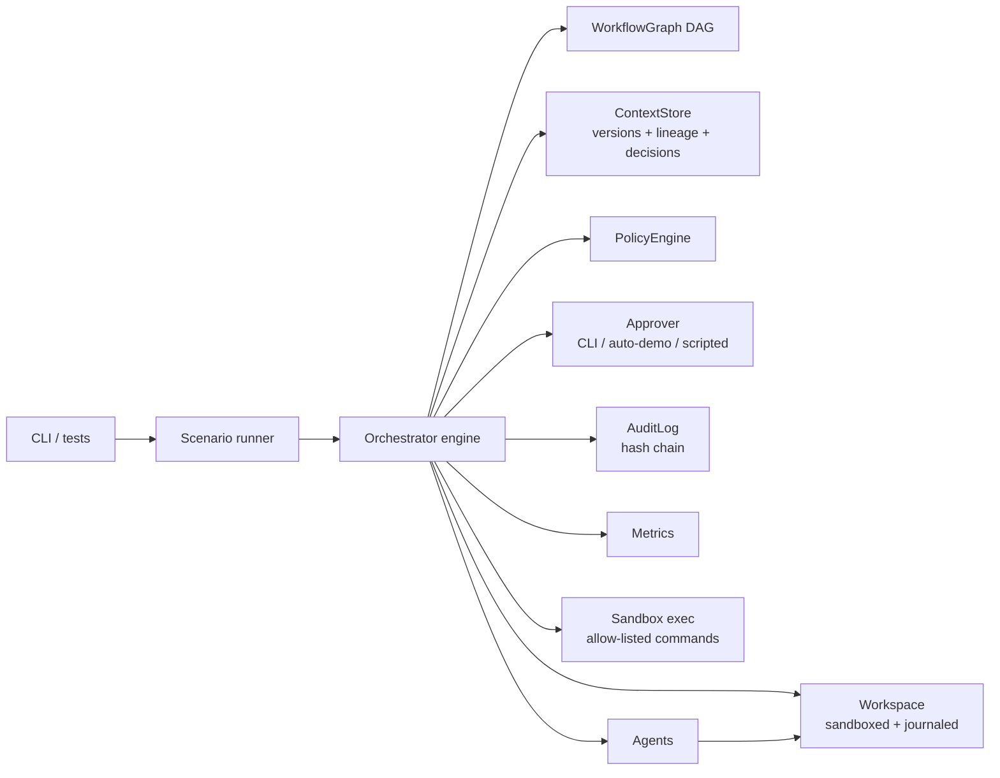
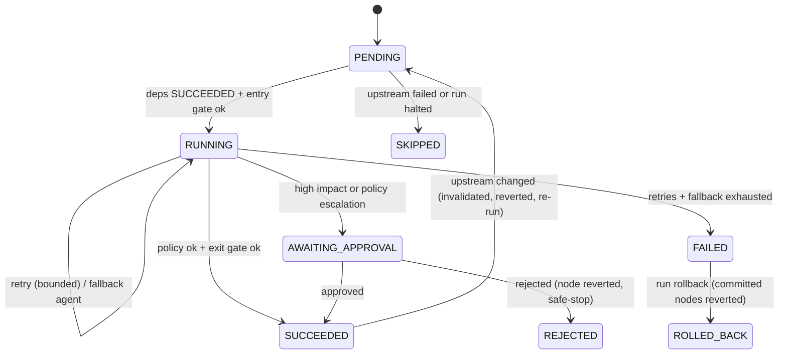

# Architecture

## Components

| Module | Responsibility |
| --- | --- |
| `graph.js` | Nodes, dependencies, cycle detection, topological levels, descendants/ancestors, rule CHG-002 |
| `engine.js` | Scheduler loop, node lifecycle, gates, retries/fallback, approvals, rollback, safe-stop, re-plan, invalidation, evidence |
| `context.js` | Versioned node outputs (version bumps only when content hash changes), consumed-input versions, decision log |
| `policy.js` | Rules evaluated on artifacts, commands and change size; severities warn / escalate / block / critical |
| `workspace.js` | Path-confined writes with a per-node journal so any node can be reverted exactly |
| `audit.js` | Append-only JSONL with `prevHash`/`hash` chain; `verify()` detects tampering |
| `metrics.js` | Success rate, retries, rollbacks, fallbacks, MTTR, approval wait, latency |
| `approvers.js` | Human-in-the-loop interface (`decide`, `answer`) with a recorded `mode` |
| `sandbox.js` | Runs only allow-listed commands with stripped env and timeout |

## Node lifecycle

## Control flow of one attempt
1. Entry gate (preconditions) -> failure is terminal for the node.
2. Agent runs with a **read-only, upstream-only** context (`ctx.get` rejects non-ancestors, so hidden coupling cannot bypass invalidation).
3. Every artifact is policy-checked **before** being written. `critical` => safe-stop the whole run; `block` => attempt fails.
4. Artifacts are written through the journaled workspace.
5. Exit gate validates (for test nodes this *executes the generated tests*). Failure => revert this attempt's writes, retry, then fallback agent.
6. Approval checkpoint if `approval.required` or a policy rule escalated.
7. Commit: context version bumped; if the output hash changed on a re-run, **all descendants are invalidated and reverted**, then re-executed under the same gates and approvals.

## Re-planning
* **Structural**: an agent may return `replan { insert, before }`. The engine adds nodes/edges, re-validates the DAG (invalid plans, e.g. a high-impact node without approval, are rejected and audited), and invalidates already-completed dependents.
* **Data**: `updateOutput(node, value)` records a new version and stales everything downstream (used by the ambiguous scenario when a stakeholder revises an answer mid-run).
* Bounded by `maxReplans`.

## Safe-stop triggers
critical policy violation, attempt budget, failure budget, re-plan budget, human rejection, unobtainable approval, operator `requestSafeStop()`.

## Key decisions and trade-offs

| Decision | Why | Trade-off |
| --- | --- | --- |
| Deterministic agents behind a contract | Reproducible, testable, auditable offline | Not real code generation; seam documented |
| Validation as **exit gates that execute tests** | Evidence over claims; failed output never commits | Slower nodes; needs sandboxing (allow-list, timeout) |
| Journaled workspace instead of git | Exact per-node revert with no external tool | Not a real VCS history; evidence is in audit + lineage |
| Hash-chained JSONL audit | Tamper-evident, zero deps | Detects tampering but does not prevent it (needs WORM storage in prod) |
| Rollback-all on terminal failure | All-or-nothing delivery | Discards good partial work (use `onFailure: 'isolate'` to keep) |
| Content-hash versioning | Avoids needless re-execution when upstream rewrite is a no-op | Hash is over JSON output; non-deterministic outputs would always re-trigger |
| In-process execution | Simple and deterministic | No resume after process crash; no distributed workers |

## Reference service (the delivered product)
Layered `app.js` (routing, auth, errors) -> `validator.js` / `shortcode.js` / `ratelimiter.js` -> async store port (`MemoryStore`, `FileStore`). See generated ADR-001..007 in a run's `docs/adr/`.
