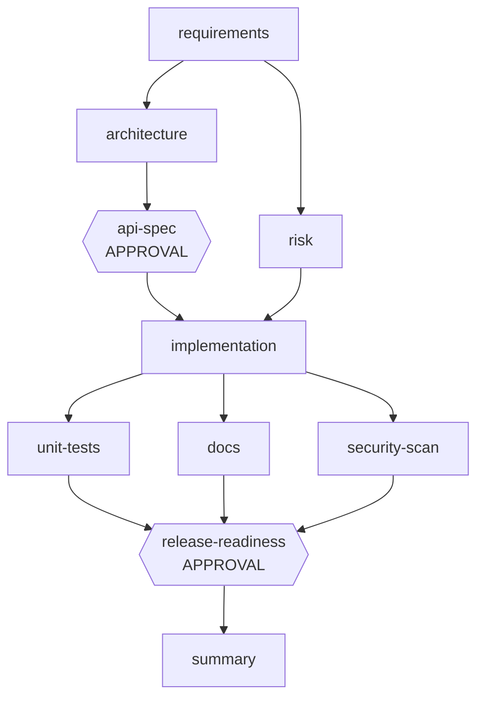
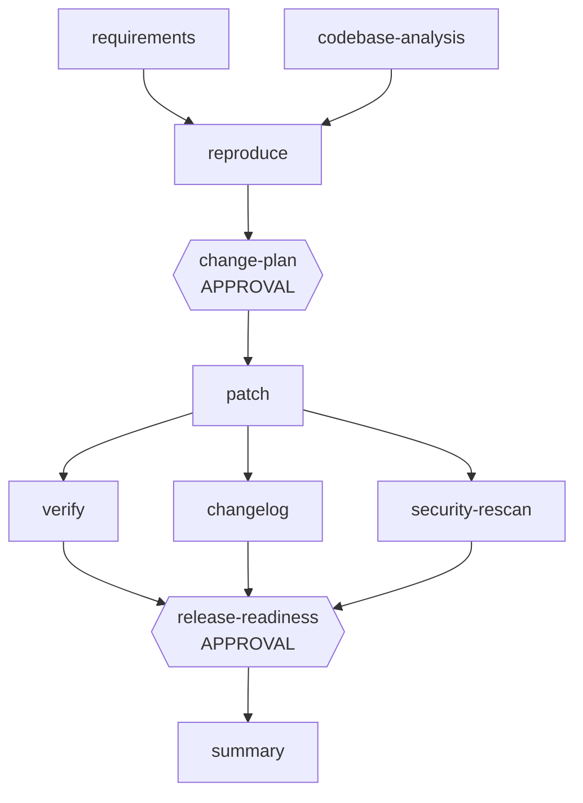

# Scenarios

Run any of them: `npm run demo:greenfield | demo:brownfield | demo:ambiguous | demo:all` (auto-approve demo) or `node src/cli.js <name>` for interactive approvals. Add `--chaos` to inject transient failures.

## 1. Greenfield: precise requirement
**Input:** REST shortener with alias, expiry (<= 30 days), 302, analytics, 10/min rate limit, API-key management, persistence.

* **Decomposition:** 10 nodes; architecture and risk run in parallel; tests, docs and security scan run in parallel and join at release.
* **Orchestration shown:** parallel batches + sync, entry gate (implementation requires the approved contract), exit gates (OpenAPI covers all operations; the generated suite actually runs), two human checkpoints, spec-derived config (30-day max TTL, 10/min limit) injected into code.
* **Validation:** requirement-traced acceptance tests (test titles carry FR ids), security scan, release checklist (every risk maps to an existing test file).
* **`--chaos`:** first attempts of `implementation` and `security-scan` fail; bounded retry recovers; MTTR and first-attempt rate are reported.

## 2. Brownfield: security bug in a legacy service
**Input:** "POST /shorten accepts javascript:/data:/file: URLs; reject non-http(s)."

* **Codebase reasoning:** import graph + route map of the real workspace; `src/app.js` is impacted (owns `/shorten`), `src/index.js` is a dependent, `codegen.js`/`store.js` are unaffected.
* **Reproduce first:** the regression test must be **red** on unmodified code (exit gate), otherwise the node fails.
* **Primary strategy (naive):** inline `startsWith('http')`. It fails the `httpevil:foo` case, so the gate rejects it, the attempt is reverted, one bounded retry fails identically, then the **fallback strategy** (validator module with protocol allow-list) passes.
* **Governance:** breaking-change plan needs approval before any code is touched; patch size feeds the change budget (CHG-003) and can escalate to approval; blast-radius check compares changed files with the impact analysis.

## 3. Ambiguous: vague stakeholder request
**Input:** "make long links short and not live forever... see how their links are doing... fast and safe, ideally scalable."

* The requirements agent flags 5 ambiguities (3 blocking: lifetime, analytics, security scope) and **re-plans**, inserting a `clarify` node before `architecture` and `risk`.
* `clarify` asks the human; unanswered questions take documented defaults and are recorded as **assumptions requiring confirmation**.
* Mid-run, a simulated stakeholder revises the lifetime from 14 to 7 days: `clarify` becomes v2, `architecture` and `risk` are invalidated and reverted, re-run, and every later node is produced from the revised spec. Final `spec-config.json` has `defaultTtlSeconds: 604800`.
* Flags: `--no-revision` skips the mid-run change.
